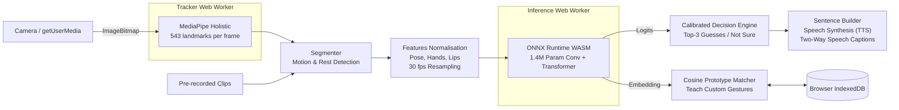

# M-ABLE

**Making Ability Accessible.**

*Intelligent Accessibility & Assistive Communication Ecosystem.*

[](https://github.com/okuhle-creator/M-ABLE/actions/workflows/deploy.yml)
[](https://github.com/okuhle-creator/M-ABLE/actions/workflows/ci.yml)
[](LICENSE)

---

## 1. Product Overview

**M-ABLE** is a client-side, browser-native assistive communication platform designed for individuals who communicate using sign language, educators, speech-language pathologists, researchers, and accessibility evaluators. 

M-ABLE transforms real-time webcam video into recognized American Sign Language (ASL) isolated signs using lightweight computer vision and neural inference running directly in the visitor's browser. It features a complete communication suite including sentence construction, text-to-speech synthesis (TTS), live two-way conversation partner captions, interactive sign language practice, and personalized few-shot gesture adaptation.

### Problem Statement

Over 70 million Deaf and hard-of-hearing individuals worldwide use sign language as their primary or preferred language. However, communication barriers persist in everyday environments—healthcare clinics, service counters, educational spaces, and workplace meetings—where conversation partners often lack sign language fluency. Conventional digital solutions frequently suffer from:
1. **Severe Privacy Hazards:** Cloud-reliant systems upload continuous webcam video streams of private conversations and personal environments to remote servers.
2. **Bandwidth Dependency & High Latency:** Video streaming requires high-speed connectivity and introduces latency unsuitable for fluid conversational turns.
3. **Impersonal Vocabulary:** Most systems fail to support idiosyncratic, regional, or personalized gestures used by individuals with motor or speech differences.

### Objectives

- **Democratize Accessible Communication:** Enable instant, browser-based sign language translation on everyday laptops, tablets, and smartphones without app store installations or account logins.
- **Enforce Absolute Privacy:** Guarantee 100% on-device processing. No camera frames, landmark coordinates, or voice audio ever leave the user's hardware.
- **Bridge Two-Way Dialogue:** Provide a complete round-trip communication system where signers build sentences that M-ABLE speaks aloud, and hearing partners speak while M-ABLE transcribes live captions.
- **Facilitate Education & Adaptation:** Empower hearing parents and allies to learn ASL interactively with objective feedback, while allowing signers to teach M-ABLE custom gestures via few-shot neural embeddings.

---

## 2. Technical Architecture & Technologies

M-ABLE separates computer vision landmark extraction, feature engineering, and neural inference across dedicated background Web Workers to guarantee 60 fps main-thread UI responsiveness:



### Technology Stack

| Layer | Technologies & Runtimes |
|---|---|
| **Frontend Framework** | React 19, TypeScript, Vite |
| **Styling & Design System** | Tailwind CSS v4, Custom Editorial Accessible Palette (Warm Ivory & Charcoal with Muted Sage/Teal accents) |
| **Computer Vision Engine** | Google MediaPipe Tasks Vision (Holistic 543 spatial landmarks) |
| **Neural Runtime** | Microsoft ONNX Runtime Web (WebAssembly SIMD-threaded) |
| **Icons & Visuals** | Lucide React |
| **Speech Services** | Web Speech API (`SpeechSynthesis` and `SpeechRecognition`) |
| **Client Storage** | IndexedDB (`fake-indexeddb` in tests) & `localStorage` |
| **Quality Assurance** | Vitest, ESLint (strict type-checked), Playwright, Prettier |

---

## 3. AI Recognition Workflow

1. **Kinematic Landmark Extraction:**
   Every incoming camera frame is transferred as an zero-copy `ImageBitmap` to the Tracker Web Worker. MediaPipe Holistic detects 543 landmarks spanning hands (42 points), pose (33 points), and facial lip contour (40 points).
2. **Temporal Segmentation & Rest Detection:**
   The Segmenter monitors hand elevation and velocity relative to shoulder baselines. When hands rise and articulate, frames buffer into an active candidate sequence. When hands rest or drop, the sequence completes and dispatches for classification.
3. **Geometric Feature Normalization:**
   Landmark coordinates are centered around shoulder midpoints, normalized by shoulder span distance, and horizontally standardized so that signing hands articulate predictably regardless of left/right dominance. Sequences are resampled to a consistent 30 FPS.
4. **Transformer Inference:**
   The normalized sequence enters the 1.4M-parameter neural model running in the Inference Worker via ONNX Runtime WebAssembly. The model computes logits over the 250 vocabulary classes and extracts a 128-dimensional bottleneck embedding.
5. **Calibrated Decision & Uncertainty Handling:**
   Softmax probabilities are temperature-scaled and evaluated against empirical confidence thresholds derived from held-out signers. If the top probability falls below the calibrated threshold, or if shoulder visibility is partial, M-ABLE outputs an honest "Not sure" with contextual user guidance.

---

## 4. Supported Capabilities

- **Two-Way Communication Studio:** Dedicated split-perspective conversational suite bridging Deaf signers (Sign → Text → Speech) and hearing partners (Speech → High-Contrast Live Captions → Quick Responses).
- **Isolated Sign Recognition:** Real-time recognition across a verified vocabulary of 250 isolated ASL signs with calibrated confidence scoring.
- **Interactive Sentence Builder:** Assembles recognized signs into an editable text buffer with quick-action punctuation, space insertion, undo, and clear controls.
- **Voice Output (Text-to-Speech):** Vocalizes assembled sentences using browser-native speech synthesis with configurable voices, speed, and pitch.
- **Conversation Captions (Speech-to-Text):** Transcribes spoken dialogue from hearing conversation partners onto the screen, enabling seamless two-way communication.
- **ASL Learning Centre:** Interactive curriculum with curated categories (Greetings, Emergency, Family, Everyday, Actions, Questions), daily "Sign of the Day", multi-question comprehension quizzes, and webcam practice.
- **Personal Vocabulary & Flashcards:** Bookmark key signs, study with interactive flip cards, and review custom taught gestures.
- **Progress & Learning Analytics:** Objective local analytics showing signs practiced, mastery rates, daily streaks, and quiz performance.
- **Searchable Sign Dictionary:** Complete directory of all 250 supported signs featuring held-out test accuracy metrics, category filters, and verified external video demonstration links (Signing Savvy).
- **Teach Your Own Gestures:** Few-shot prototype studio enabling users to record 3–5 takes of custom gestures, classified via cosine similarity against stored 128-d embeddings.
- **Communication History:** Privacy-first local archive of confirmed conversations with audio replay, clipboard copying, and JSON/TXT export.
- **Accessibility & Sensory Controls:** Includes Light (Warm Ivory), Dark (Charcoal), and System themes, text size scaling (Standard, Large, Extra Large), Reduced Motion overrides, High Contrast mode, and User Persona profiles.

---

## 5. Known Limitations

- **Isolated vs. Continuous ASL:** M-ABLE recognizes **isolated** sign language gestures. It is not a continuous natural ASL sentence translator and does not parse complex spatial grammar, non-manual facial grammatical markers, or fluid fingerspelling sequences.
- **Vocabulary Scope:** The onboard neural model is trained strictly on 250 specific sign classes from the Kaggle `asl-signs` corpus. Signs outside this vocabulary require training via the custom gesture studio.
- **Camera Framing & Illumination:** Hand tracking requires both hands and upper shoulders to remain visible within the camera frame. Extreme backlighting or low-light conditions may degrade landmark detection.
- **Browser Speech API Compatibility:** Text-to-Speech (`SpeechSynthesis`) is supported across all major modern browsers. Speech-to-Text Captions (`SpeechRecognition`) require Chromium-based browsers (Chrome, Edge) or Safari.

---

## 6. Privacy & Security by Design

- **Zero Cloud Upload:** Camera video is processed entirely in volatile browser memory. No video, image snapshots, or landmark coordinates are transmitted over any network socket.
- **Strict Content Security Policy (CSP):** The production build injects a strict `<meta>` CSP (`default-src 'self'; script-src 'self' 'wasm-unsafe-eval'; connect-src 'self'`) forbidding any external asset loading or third-party tracking.
- **Zero Account or Telemetry Burden:** No analytics, user profiling, cookies, or telemetry libraries are bundled.
- **Local Sandbox Storage:** Taught custom gestures and communication transcripts are saved exclusively in the user's browser sandbox (IndexedDB and `localStorage`).

---

## 7. Local Development & Installation

### Prerequisites

- **Node.js 24+** (LTS recommended)
- Modern browser supporting WebAssembly SIMD and WebRTC camera access (Chrome, Edge, Firefox, or Safari)

### Quick Start

```bash
# 1. Clone the repository
git clone https://github.com/okuhle-creator/M-ABLE.git
cd M-ABLE/web

# 2. Install dependencies
npm ci

# 3. Start the local development server
npm run dev
```

Open `http://localhost:5330/M-ABLE/` in your browser.

### Quality Assurance & Testing Suite

Execute the full suite of verification commands before committing changes:

```bash
# Typecheck TypeScript codebase
npm run typecheck

# Verify ESLint rules with zero-warning tolerance
npm run lint

# Execute full Vitest suite (135 tests)
npm test

# Build production bundle with verified asset checksums
npm run build

# Run end-to-end Playwright accessibility tests
npm run test:e2e
```

---

## 8. GitHub Pages Deployment Configuration

M-ABLE is configured for continuous automated deployment to GitHub Pages via `.github/workflows/deploy.yml`.

### One-Time Repository Setup

To activate GitHub Pages for your fork or repository:

1. Navigate to **GitHub** → your repository: `https://github.com/okuhle-creator/M-ABLE`
2. Click **Settings** (top navigation bar).
3. In the left sidebar, click **Pages** (under *Code and automation*).
4. Under **Build and deployment** → **Source**, select **GitHub Actions** from the dropdown menu.

### Automated Publishing

Any commit pushed to the `m-able/development` branch triggers an automated build and deployment.

### Manual Trigger ("Run workflow")

You can also trigger a production deployment manually at any time:

1. Navigate to the **Actions** tab in GitHub.
2. Under the workflows list on the left, click **Deploy M-ABLE to GitHub Pages**.
3. Click the **Run workflow** dropdown button on the right.
4. Select branch **`m-able/development`** and click the green **Run workflow** button.

Once deployed, the live site is served at:
```
https://okuhle-creator.github.io/M-ABLE/
```

---

## 9. Attribution & Licenses

- **Original Architecture & Pipeline:** Built upon the open-source foundation of [GestureSign](https://github.com/shashank11yadav/GestureSign) by [Shashank Yadav](https://www.shashankyadav.dev/) under the MIT License.
- **Machine Learning Dataset:** [Google – Isolated Sign Language Recognition](https://www.kaggle.com/competitions/asl-signs) (Kaggle `asl-signs`), licensed under [CC BY 4.0](https://creativecommons.org/licenses/by/4.0/).
- **Landmark Extraction:** [Google MediaPipe Holistic](https://github.com/google/mediapipe) (Apache 2.0).
- **Neural Runtime:** [Microsoft ONNX Runtime Web](https://github.com/microsoft/onnxruntime) (MIT License).
- **Sign Demonstrations:** External reference links provided via [Signing Savvy](https://www.signingsavvy.com/).

### License

M-ABLE is released under the [MIT License](LICENSE).  
Copyright (c) 2026 M-ABLE Contributors and Original Author Shashank Yadav.
