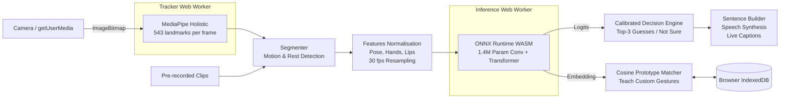

# M-ABLE

**Making Every Ability Understood.**

*Intelligent Accessibility & Assistive Communication Technology.*

[](https://github.com/okuhle-creator/M-ABLE/actions/workflows/deploy.yml)
[](https://github.com/okuhle-creator/M-ABLE/actions/workflows/ci.yml)
[](LICENSE)

---

## Overview

**M-ABLE** is a client-side, browser-native assistive communication platform designed for individuals who communicate using sign language, educators, researchers, and accessibility evaluators. 

M-ABLE transforms real-time webcam video into recognized American Sign Language (ASL) isolated signs using lightweight computer vision and neural inference running directly in the visitor's browser. It features a complete communication suite including sentence construction, speech synthesis (TTS), accessible conversation captions, interactive sign language practice, and personalized few-shot gesture adaptation.

### Core Capabilities

- **Real-Time Isolated Sign Recognition:** Recognizes 250 isolated ASL signs at up to 30 fps with calibrated confidence scoring.
- **Sentence Builder & Speech Synthesis:** Assemble recognized signs into sentences, edit phrases in real time, and vocalize them aloud via the Web Speech API.
- **Conversation Captions:** High-contrast, large-format live captions designed for two-way accessibility in noisy or quiet environments.
- **Practice Studio:** Interactive sign language learning with immediate score feedback benchmarked against true model confidence.
- **Teach Your Own Gestures:** Few-shot prototype embedding adaptation allowing users to train personal or non-standard gestures using 3–5 takes, persisted in local IndexedDB.
- **Sign Dictionary:** Searchable reference index of all 250 supported signs with execution tips and one-click practice launch.
- **Strict Privacy-by-Design:** 100% on-device processing. No webcam video, landmark coordinates, or voice audio ever leaves the browser. Zero telemetry, zero external trackers, zero accounts required.

---

## Technical Architecture

M-ABLE separates computer vision landmark extraction, feature engineering, and neural inference across dedicated background Web Workers to guarantee 60 fps main-thread UI responsiveness:



### ML Pipeline & Provenance

- **Model Architecture:** 1.4M-parameter temporal convolutional network combined with transformer encoder layers.
- **Inference Runtime:** ONNX Runtime WebAssembly (WASM SIMD).
- **Landmark Extraction:** MediaPipe Holistic landmarker extracting 543 spatial coordinates per frame (hands, pose, and lips).
- **Training Foundation:** Google Isolated Sign Language Recognition dataset (asl-signs, Kaggle CC BY 4.0), comprising 94k clips across 21 signers. Shipped model achieves 72.1% top-1 and 88.1% top-5 accuracy across held-out evaluation signers.
- **Custom Gesture Engine:** Nearest prototype matching in the model's bottleneck embedding space (88.7% accuracy with 8 gestures at 3 takes each).

---

## Deployment to GitHub Pages

M-ABLE is configured for automated, single-click continuous deployment to GitHub Pages using the official GitHub Actions workflow.

### 1. Configure GitHub Repository Settings

To enable deployment, the repository owner must configure GitHub Pages to use GitHub Actions as the deployment source:

1. Navigate to the GitHub repository: `https://github.com/okuhle-creator/M-ABLE`
2. Click **Settings** (top navigation).
3. In the left sidebar, click **Pages** (under the "Code and automation" section).
4. Under **Build and deployment** → **Source**, select **GitHub Actions** from the dropdown menu.

### 2. Manual Trigger ("Run workflow")

Once GitHub Actions is selected as the source, you can trigger a deployment anytime:

1. Click the **Actions** tab at the top of the repository.
2. In the left workflow list, select **Deploy M-ABLE to GitHub Pages**.
3. Click the **Run workflow** dropdown button on the right.
4. Select the **`m-able/development`** branch (or target branch) and click **Run workflow**.

The workflow (`.github/workflows/deploy.yml`) will:
- Check out the repository.
- Set up Node.js 24 with package caching.
- Install dependencies (`npm ci`).
- Run the unit test suite (`npm test`).
- Execute production asset fetching and build with the `/M-ABLE/` base URL (`npm run build`).
- Package and deploy `web/dist` directly to the `github-pages` environment.

Once complete, your site will be accessible at:
```
https://okuhle-creator.github.io/M-ABLE/
```

---

## Local Development

### Prerequisites

- **Node.js 24+** (LTS recommended)
- Modern browser with WebAssembly SIMD and WebRTC camera access (Chrome, Edge, Firefox, or Safari)

### Quick Start

```bash
# Clone the repository
git clone https://github.com/okuhle-creator/M-ABLE.git
cd M-ABLE/web

# Install dependencies
npm ci

# Start the local development server
npm run dev
```

Visit `http://localhost:5330/M-ABLE/` in your browser.

### Quality Verification Commands

| Command | Purpose |
|---|---|
| `npm test` | Runs the full Vitest suite (135+ tests covering ML, segmenter, features, session, and speech). |
| `npm run typecheck` | Validates TypeScript types across the entire web application (`tsc -b`). |
| `npm run lint` | Runs ESLint with zero-warning threshold (`eslint . --max-warnings 0`). |
| `npm run format:check` | Verifies code styling via Prettier. |
| `npm run build` | Compiles the production bundle into `web/dist` with verified assets. |
| `npm run test:e2e` | Runs Playwright end-to-end accessibility and interaction tests. |
| `npm run bench` | Runs browser landmark extraction benchmark suite. |

---

## Privacy & Security

- **Zero Cloud Video Ingestion:** Camera video streams are ingested strictly into local browser memory via `navigator.mediaDevices.getUserMedia` and piped to Web Workers as `ImageBitmap`.
- **Strict Content Security Policy (CSP):** Strict CSP headers (`script-src 'self' 'wasm-unsafe-eval'`) prevent arbitrary remote code execution and third-party injection.
- **Local Persistence Only:** Taught gestures and saved sentence histories are stored exclusively in browser IndexedDB and `localStorage`.

---

## Attribution & Credits

- **Core Foundation:** Built upon the [GestureSign](https://github.com/shashank11yadav/GestureSign) architecture originally created by [Shashank Yadav](https://shashankyadav.dev/) (MIT License).
- **Dataset:** [Google – Isolated Sign Language Recognition](https://www.kaggle.com/competitions/asl-signs/data) (Kaggle asl-signs), licensed under CC BY 4.0.
- **Landmark Engine:** [Google MediaPipe Holistic](https://github.com/google/mediapipe) (Apache 2.0).
- **Neural Inference Engine:** [Microsoft ONNX Runtime Web](https://github.com/microsoft/onnxruntime) (MIT License).
- **Sign Language Dictionaries:** Sign demonstrations and cross-references via [Signing Savvy](https://www.signingsavvy.com/).

---

## License

This project is licensed under the [MIT License](LICENSE).
The underlying Kaggle ASL dataset retains its [CC BY 4.0](https://creativecommons.org/licenses/by/4.0/) license.
